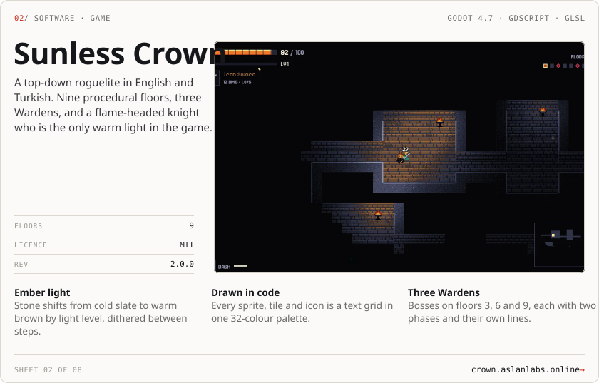
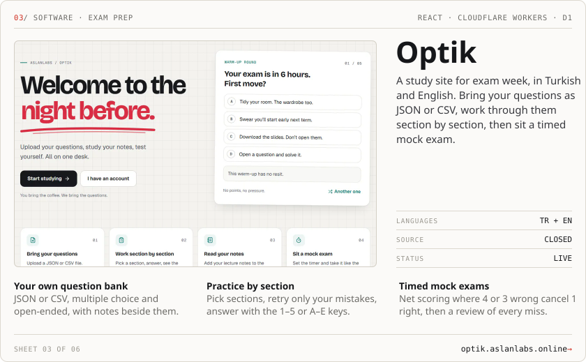
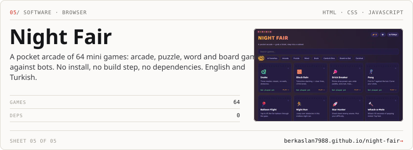
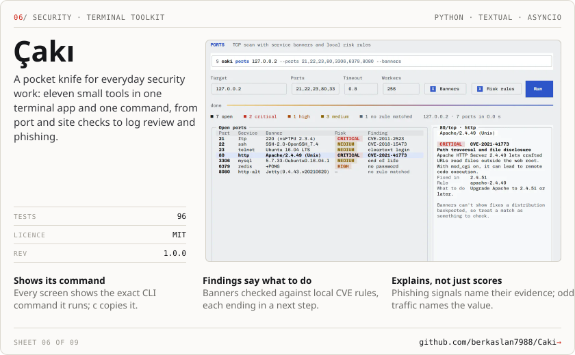
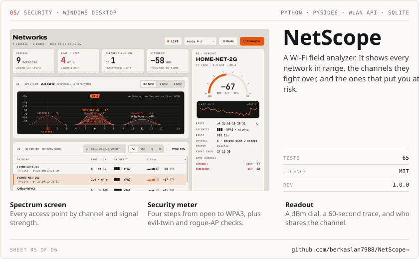
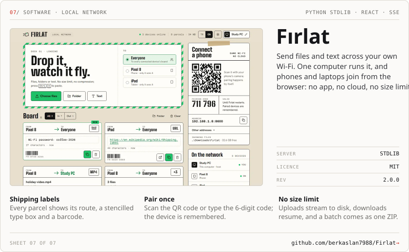
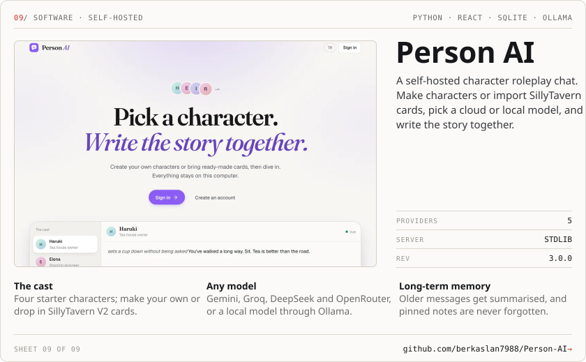

<picture>
  <source media="(prefers-color-scheme: dark)" srcset="assets/header-dark.svg">
  
</picture>

I'm an Information Systems and Technologies student, splitting my time between creating software and studying security.

<a href="https://cysec.aslanlabs.online">
<picture>
  <source media="(prefers-color-scheme: dark)" srcset="assets/cysec-dark.svg">
  
</picture>
</a>

<a href="https://crown.aslanlabs.online">
<picture>
  <source media="(prefers-color-scheme: dark)" srcset="assets/sunless-crown-dark.svg">
  
</picture>
</a>

<a href="https://github.com/berkaslan7988/NetSentinel">
<picture>
  <source media="(prefers-color-scheme: dark)" srcset="assets/netsentinel-dark.svg">
  
</picture>
</a>

<a href="https://optik.aslanlabs.online">
<picture>
  <source media="(prefers-color-scheme: dark)" srcset="assets/optik-dark.svg">
  
</picture>
</a>

<a href="https://nf.aslanlabs.online">
<picture>
  <source media="(prefers-color-scheme: dark)" srcset="assets/night-fair-dark.svg">
  
</picture>
</a>

<a href="https://github.com/berkaslan7988/Caki">
<picture>
  <source media="(prefers-color-scheme: dark)" srcset="assets/caki-dark.svg">
  
</picture>
</a>

<a href="https://github.com/berkaslan7988/NetScope">
<picture>
  <source media="(prefers-color-scheme: dark)" srcset="assets/netscope-dark.svg">
  
</picture>
</a>

<a href="https://github.com/berkaslan7988/Firlat">
<picture>
  <source media="(prefers-color-scheme: dark)" srcset="assets/firlat-dark.svg">
  
</picture>
</a>

<a href="https://github.com/berkaslan7988/Person-AI">
<picture>
  <source media="(prefers-color-scheme: dark)" srcset="assets/person-ai-dark.svg">
  
</picture>
</a>

**Toolbox** &nbsp; `Python` `PySide6` `Textual` `Scapy` `scikit-learn` `PyTorch` · `React` `TypeScript` `Vite` `SQLite` · `Rust` · `Godot` `GDScript` · `Cloudflare Workers`

[berkaslan7988@gmail.com](mailto:berkaslan7988@gmail.com)
