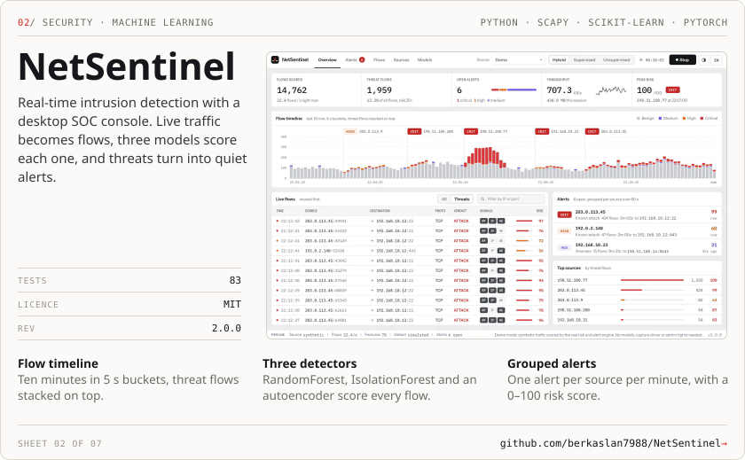
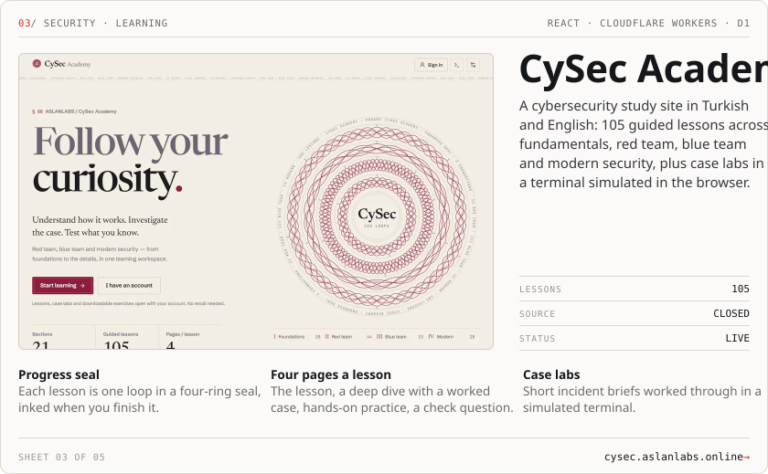

<picture>
  <source media="(prefers-color-scheme: dark)" srcset="assets/header-dark.svg">
  
</picture>

I'm a fourth-year Information Systems and Technologies student, splitting my time between writing software and studying security. Lately that means Windows tools that watch networks, a security course in Turkish, and apps that keep your data on your own machine. Each sheet below is a project I keep improving; click one to open it.

<a href="https://github.com/berkaslan7988/NetScope">
<picture>
  <source media="(prefers-color-scheme: dark)" srcset="assets/netscope-dark.svg">
  
</picture>
</a>

<a href="https://github.com/berkaslan7988/NetSentinel">
<picture>
  <source media="(prefers-color-scheme: dark)" srcset="assets/netsentinel-dark.svg">
  
</picture>
</a>

<a href="https://cysec.aslanlabs.online">
<picture>
  <source media="(prefers-color-scheme: dark)" srcset="assets/cysec-dark.svg">
  
</picture>
</a>

<a href="https://github.com/berkaslan7988/Person-AI">
<picture>
  <source media="(prefers-color-scheme: dark)" srcset="assets/person-ai-dark.svg">
  
</picture>
</a>

<a href="https://berkaslan7988.github.io/night-fair/">
<picture>
  <source media="(prefers-color-scheme: dark)" srcset="assets/night-fair-dark.svg">
  
</picture>
</a>

**Toolbox** &nbsp; `Python` `PySide6` `Scapy` `scikit-learn` `PyTorch` · `React` `Vite` `SQLite` · `Rust` · `Cloudflare Workers`

[berkaslan7988@gmail.com](mailto:berkaslan7988@gmail.com)
